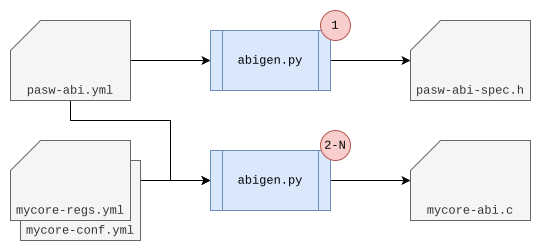

Packet Architects Switch Driver
===============================

This directory contains a [DSA][dsa] driver for switches and SmartNICs
built around [Packet Architects'][packetarc] FlexSwitch cores.

### Code Generation

As the name implies, there is a lot of variance in the feature set of
FlexSwitch designs. Furthermore, the cores are synthesized in such a
way that the locations of registers, indeed even offsets of bit fields
inside of registers, are dynamic.

To accommodate this structure, the driver leverages code generation to
derive _ABI implementations_ from a design's _register- and
configuration specification_.

There are two classes of inputs to the code generation:

- `pasw-abi.yml`: This contains all of the attributes, values, and
  tables, that the _driver supports_. Most of the declared items are
  mandatory, i.e., the driver will only work on FlexSwitch _designs_
  that implements this subset. Others could be optional, e.g., the
  driver could support a large superset of ACL keys and actions, and
  then dynamically report the supported subset of a particular design
  to the kernel's TC layer.

- `mycore-{conf,regs}.yml`: These files are output artifacts from the
  build of the switchcore itself - i.e., they are provided by Packet
  Architects along with the corresponding bitstream. They detail the
  FlexSwitch configuration (`mycore-conf.yml`) and the exact location
  of all registers and fields (`mycore-regs.yml`)

From the inputs, `abigen.py` (located in `tools/`) then runs in two
phases to create the required outputs:

1. From `pasw-abi.yml`, `pasw-abi-spec.h` is created. This contains
   the definition of `struct pasw_abi`, which each design must provide
   an implementation of. The generated header is not usable on its
   own, the only direct user is `pasw-abi.h`, which contains the
   static definitions of things like fields and tables that the
   generated file relies on.

2. From the configuration and register specifications of a design
   (`mycore-{conf,regs}.yml`), along with the subset supported by the
   driver (`pasw-abi.yml`), `abigen.py` extracts the intersection of
   features supported both by the design and the driver. The output,
   `mycore-abi.c`, contains an implementation of `struct pasw_abi`,
   that can be supplied to an instance of the driver to drive that
   particular core.

Step 2 is repeated once for each design the driver needs to support.

Since the FlexSwitch does not come with a native MAC implementation,
nor with any PCI-e interface or DMA engine, it is typically one block
in a larger device. Device implementations are therefore expected to
include the ABI implementation (`mycore-abi.c`) as part of building
the full driver.

[dsa]:       https://docs.kernel.org/networking/dsa/dsa.html
[packetarc]: https://www.packetarc.com/
